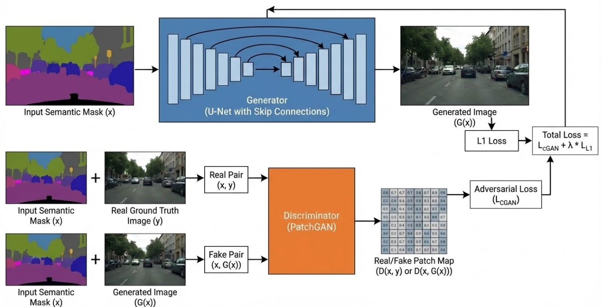

# Mask-to-Image Generation with cGAN (Pix2Pix)

This repository contains the project developed for the **Deep Learning and Generative Models** course taught by **Prof. Andrea Prati** at the **University of Parma** (Università di Parma).

The objective of this project is semantic image synthesis: translating semantic segmentation masks into photorealistic street-view images using the **Cityscapes** dataset.

---

## 📌 Project Overview

Image-to-image translation is a challenging task in computer vision that requires mapping semantic labels to rich, realistic pixel representations. 

### From U-Net to Conditional GAN (Pix2Pix)

- **Initial Approach (Baseline U-Net):**  
  The project initially explored a standard **U-Net** architecture (an encoder-decoder network with skip connections) trained solely with standard pixel-wise reconstruction losses ($L_1$ and MSE). While the U-Net learned to reconstruct overall semantic layout and color distributions, pixel-level losses alone inherently average plausible textures, resulting in blurry outputs and lacking fine high-frequency details.

- **Evolution to Conditional GAN (Pix2Pix):**  
  To overcome blurriness and encourage structural sharpness, the architecture evolved into a **Conditional Generative Adversarial Network (cGAN)** inspired by the **Pix2Pix** framework (Isola et al.):
  - **Generator ($G$):** A deep U-Net conditioned on the input semantic mask to synthesize RGB images.
  - **Discriminator ($D$):** A PatchGAN discriminator penalizing unrealistic structures at the local patch scale, conditioned on both the input mask and the real/generated image pairs.
  - **Objective Function:** A joint loss combining an adversarial loss (Vanilla BCE or LSGAN) and an $L_1$ pixel reconstruction loss ($\mathcal{L}_{\text{cGAN}} + \lambda \mathcal{L}_{L_1}$), balancing global consistency and high-frequency realism.

---

## 🏗️ Architecture

<p align="center">
  
</p>

---

## 🚀 Getting Started

### 1. Requirements

Ensure you have Python 3.9+ installed with PyTorch and dependencies:

```bash
pip install torch torchvision numpy scikit-image Pillow tqdm torchmetrics requests
```

### 2. Dataset Setup

Download the [Cityscapes dataset](https://www.cityscapes-dataset.com/) (specifically `gtFine_trainvaltest.zip` and `leftImg8bit_trainvaltest.zip`) and organize the directory as follows:

```
data/
├── gtFine/
│   ├── train/
│   └── val/
└── leftImg8bit/
    ├── train/
    └── val/
```

### 3. Training

#### Train Baseline U-Net:
```bash
python main.py \
  --model_type unet \
  --run_name "unet_baseline" \
  --epochs 100 \
  --batch_size 16 \
  --loss_function L1
```

#### Train Pix2Pix cGAN:
```bash
python main.py \
  --model_type pix2pix \
  --run_name "pix2pix_cgan" \
  --model_name "pix2pix_final" \
  --gan_mode lsgan \
  --norm_type instance \
  --dropout 0.5 \
  --dropout_mode paper \
  --feat 64 \
  --n_layer_g 8 \
  --n_layer_d 3 \
  --lambda_l1 10.0 \
  --epochs 200 \
  --batch_size 16 \
  --augment
```

*(For Slurm/HPC clusters, refer to [`hpc.bash`](file:///Users/andreaveronesi/PycharmProjects/MaskToImage_DL/hpc.bash)).*

### 4. Inference & Image Generation

Generate images from sample semantic masks using:

```bash
python generate_image.py \
  --model_path models/run_pix2pix_feat64_100e_G_last.pth \
  --mask_path masks/frankfurt_000000_000294_gtFine_labelIds.png
```
